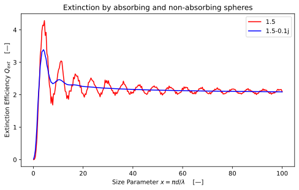
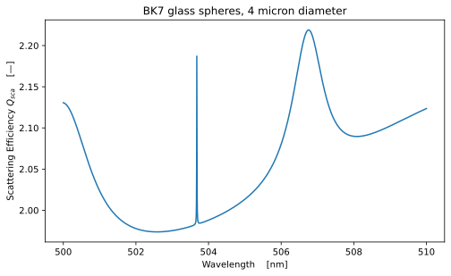
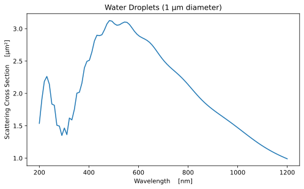
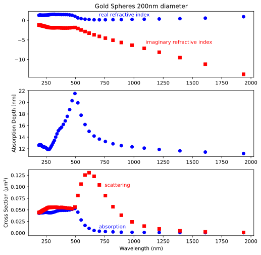
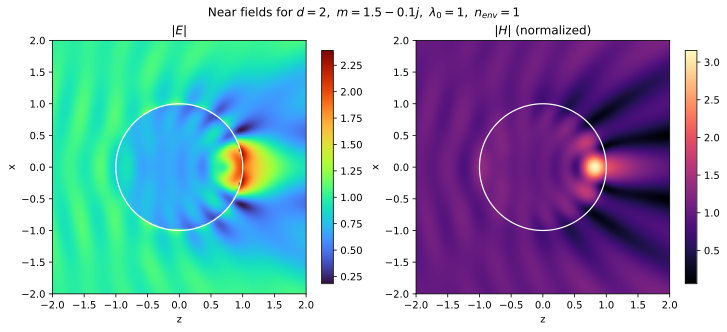

.. |test-badge| image:: https://github.com/scottprahl/miepython/actions/workflows/test.yaml/badge.svg
   :target: https://github.com/scottprahl/miepython/actions/workflows/test.yaml
   :alt: Testing

.. |pypi-badge| image:: https://img.shields.io/pypi/v/miepython?color=68CA66
   :target: https://pypi.org/project/miepython/
   :alt: PyPI

.. |pyversions-badge| image:: https://img.shields.io/pypi/pyversions/miepython?color=68CA66
   :target: https://pypi.org/project/miepython/
   :alt: Python versions

.. |conda-badge| image:: https://img.shields.io/conda/vn/conda-forge/miepython?label=conda&color=68CA66
   :target: https://github.com/conda-forge/miepython-feedstock
   :alt: Conda

.. |downloads-badge| image:: https://img.shields.io/pypi/dm/miepython?color=68CA66
   :target: https://pypi.org/project/miepython/
   :alt: Downloads

.. |license-badge| image:: https://img.shields.io/github/license/scottprahl/miepython?color=68CA66
   :target: https://github.com/scottprahl/miepython/blob/main/LICENSE.txt
   :alt: License

.. |readthedocs-badge| image:: https://readthedocs.org/projects/miepython/badge?color=68CA66
   :target: https://miepython.readthedocs.io
   :alt: Docs

.. |doi-badge| image:: https://zenodo.org/badge/DOI/10.5281/zenodo.7949263.svg
   :target: https://doi.org/10.5281/zenodo.7949263
   :alt: DOI

.. |lite-badge| image:: https://img.shields.io/badge/try-JupyterLite-68CA66.svg
   :target: https://scottprahl.github.io/miepython/
   :alt: Try JupyterLite

miepython
=========

=================  =====================================================================
**Testing**        |test-badge|
**Package**        |pypi-badge| |conda-badge| |pyversions-badge| |downloads-badge|
**Documentation**  |readthedocs-badge| |doi-badge| |license-badge|
**Explore**        |lite-badge|
=================  =====================================================================

Mie scattering calculations in pure Python
------------------------------------------

``miepython`` provides a validated and efficient implementation of Mie scattering for spherical particles.  
It reproduces established reference results (including Wiscombe's MIEV0) and is designed for scientific, educational, and computational research applications in optics.

The library implements the full Mie solution, including:

- extinction, scattering, and absorption efficiencies
- asymmetry parameter (scattering anisotropy)
- angle-resolved scattering intensities
- Mie expansion coefficients
- complex amplitude functions and Mueller matrices
- E-field and H-field calculations in the near-field around a sphere

The implementation is numerically stable for a wide range of size parameters and refractive indices, including lossy materials and high-index contrasts.

JupyterLite Implementation
--------------------------

The entire package can be used **immediately** in a browser — without installation — using the JupyterLite interface:

|lite-badge|

This environment runs entirely client-side (Pyodide), and supports:

- interactive notebooks  
- real-time plotting  
- full access to ``miepython`` functions  
- reproducible experiments (downloadable notebooks)

This makes it ideal for teaching, demonstrations, or quick exploratory calculations.

Installation
------------

Install with pip:

.. code-block:: bash

    pip install miepython

Or via conda:

.. code-block:: bash

    conda install -c conda-forge miepython

Quick Start
-----------

A typical calculation is straightforward:

.. code-block:: python

    import miepython as mie

    m = 1.5 - 0.1j     # refractive index
    d = 100            # diameter (nm)
    lambda0 = 314.15   # wavelength (nm)

    qext, qsca, qback, g = mie.efficiencies(m, d, lambda0)

Documentation and Examples
--------------------------

The full documentation is available on ReadTheDocs:

    |readthedocs-badge|

Representative results simple examples:

    https://github.com/scottprahl/miepython/tree/main/miepython/examples

Performance and Acceleration
----------------------------

``miepython`` supports optional Numba JIT compilation:

.. code-block:: python

    import os
    os.environ["MIEPYTHON_USE_JIT"] = "1"  # must be set before import
    import miepython

This can provide 10–50× speedups for large parameter sweeps or ensemble calculations.

Benchmark example (100,000 particles):

============ ============ ==========
Version      Time         Speedup
============ ============ ==========
Pure Python  4.00 s       1×
JIT Enabled  0.15 s       27×
============ ============ ==========

Citation
--------

If you use ``miepython`` in academic, instructional, or applied technical work, please cite:

Prahl, S. (2026). *miepython: Pure python calculation of Mie scattering* (Version 3.4.0) [Computer software]. Zenodo. https://doi.org/10.5281/zenodo.7949263

BibTeX:

.. code-block:: bibtex

    @software{prahl_miepython_2026,
      author  = {Scott Prahl},
      title   = {{miepython}: A Python library for Mie scattering calculations},
      url     = {https://github.com/scottprahl/miepython},
      doi     = {10.5281/zenodo.7949263},
      year    = {2026},
      version = {3.4.0},
      publisher = {Zenodo}
    }

License
-------

``miepython`` is released under the MIT License.

